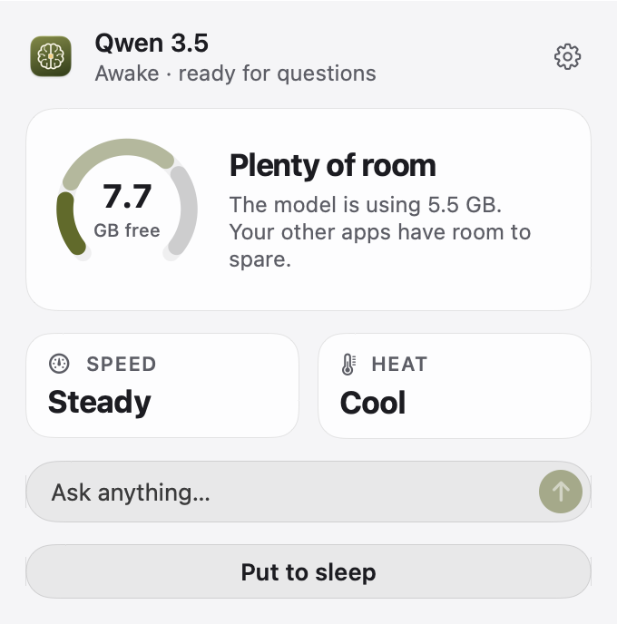
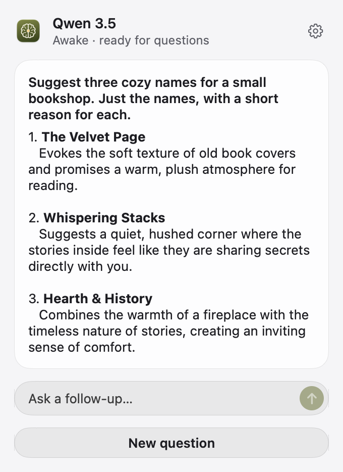

<p align="center">
  
</p>

<h1 align="center">Localist</h1>

<p align="center">Your gateway to local AI models.</p>

> **About this repository:** this is where Localist's releases and updates are published, along
> with its user guide. Localist's source code is private and isn't published here.

Localist puts capable AI models on your Mac and keeps them there. Ask a question from the menu
bar, let the apps you use share the same model, and never send a word to the cloud. There's no
account and no subscription, and once a model is on your Mac, you don't need an internet
connection.

It also takes care of the part nobody wants to think about. AI models need a lot of memory, so
Localist wakes a model when you ask, puts it to sleep when you're done, and steps aside when your
other apps need the room. When it does something on its own, it tells you why.

<p align="center">
  <picture>
    <source media="(prefers-color-scheme: dark)" srcset="assets/localist-menu-bar-dark.png">
    
  </picture>
</p>

## What you can do with it

- **Ask from the menu bar.** Click the Localist icon, type a question, and watch the answer
  appear. Ask a follow-up, or stop it mid-sentence.
- **Share one model across your apps.** Apps that work with Localist use the model that's
  already on your Mac. They don't each download their own, and your text never goes to a server.
- **Ask about pictures.** Apps can show Localist a screenshot, a chart, or a photo of a receipt
  and ask questions about it.
- **Check on your Mac at a glance.** The menu bar shows how much memory your other apps have
  left, how quickly answers are coming, and whether your Mac is running warm.
- **Get your memory back in one click.** Put the model to sleep whenever you like. It wakes
  again the next time something asks.

<p align="center">
  
</p>

## It looks after your Mac

- **Wakes when you need it.** A model loads the moment you or an app asks, and goes back to
  sleep after five quiet minutes, giving its memory back.
- **Your apps come first.** If memory runs low, the model steps aside before anything else
  slows down. Requests wait their turn and pick up again when there's room.
- **Leaves room to spare.** Localist never takes more than a safe share of your memory, a little
  under 10 GB on a 16 GB Mac.
- **Easy on battery and heat.** Work that can wait pauses while you're on battery or when your
  Mac gets hot.
- **Explains itself.** Every automatic step comes with a plain reason, like "Put Qwen 3.5 to
  sleep after 5 quiet minutes."

## Models

Localist starts with a short list of models it has tried on real Macs, checking how much memory
each one needs and how quickly it answers.

| Model | Made by | Good at |
|---|---|---|
| Qwen 3.5 | Alibaba | Everyday questions, pictures, and careful step-by-step thinking. The default pick. |
| Gemma 4 | Google | Writing, and questions about pictures. |
| Granite 4 | IBM | Quick, focused answers and writing. The lightest of the three. |

Smaller versions are there for Macs with less memory to spare. Only one model is awake at a
time, and switching takes a few seconds.

## Privacy

What you type and every answer stay on your Mac. Nothing about you or how you use the app is
collected. Localist goes online for one thing: downloading the models you choose from Hugging
Face, where their makers publish them.

Only apps on your Mac can talk to Localist. Other computers on your network can't reach it, and
neither can the websites you visit. [PRIVACY.md](PRIVACY.md) spells out what Localist keeps on
your Mac and for how long.

## Requirements

- A Mac with Apple silicon and 16 GB of memory or more.
- macOS 27 or later.
- Disk space for the models you download. The default model takes about 6 GB.

## Download and install

1. [Download Localist](https://github.com/tmanish/localist-releases/releases/latest/download/Localist.dmg)
   (always the latest version), or pick a file from [Releases](https://github.com/tmanish/localist-releases/releases/latest).
2. Open it and drag Localist to the Applications folder.
3. Open Localist from Applications and pick your first model. Localist suggests one for each
   family that fits your Mac, and shows the download size and how much memory it needs before
   you choose. Download it, then try a question while you're still in the welcome window.

Localist lives in the menu bar, not the Dock. If you close the window during the download, it
keeps going, and the menu bar shows how far along it is.

macOS lets you know that Localist added a background item. That's the part that keeps your
model ready for your apps, even when the menu is closed. You can turn it off any time in
System Settings ▸ General ▸ Login Items & Extensions.

Each release is signed with the developer's Apple Developer ID and notarized by Apple.

## For app makers

Localist gives your app a capable AI model with no server to run, no API key and no cost per
request, and your users' text never leaves their Mac. It understands the same chat format as
the OpenAI API, at a local address:

```
http://127.0.0.1:42042/v1
```

The official OpenAI SDKs for Python and JavaScript work as they are once you point them there,
and so do most tools that let you set a custom server address. Streaming, tool calling, JSON
that follows a schema, and questions about images all work. [DEVELOPERS.md](DEVELOPERS.md) has
examples in Python, JavaScript, Swift and curl, the model names to ask for, and what to expect
when Localist is busy.

## Help

- [User guide](HELP.md)
- [Privacy](PRIVACY.md)
- [For developers](DEVELOPERS.md)
- In the app: click the gear in the Localist menu, then choose Localist Help, Privacy or For
  Developers.

## Feedback

Found a bug or have an idea? [Open an issue](https://github.com/tmanish/localist-releases/issues).
Please describe the problem rather than attaching anything private.
